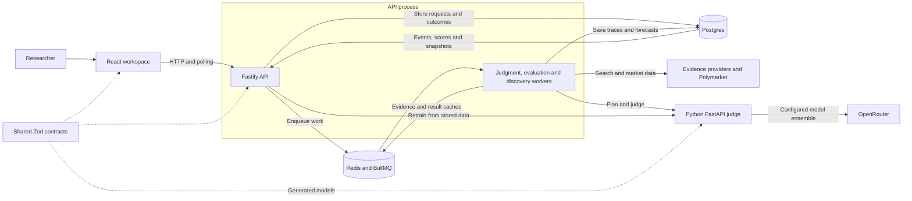
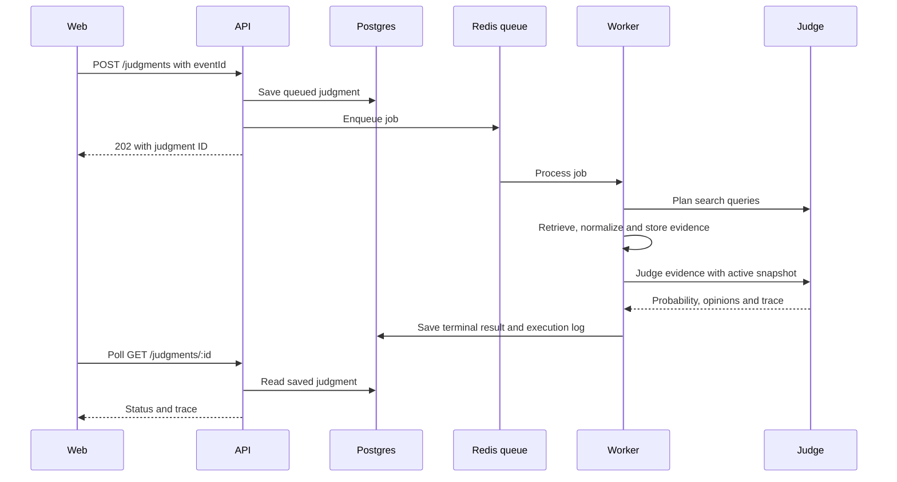
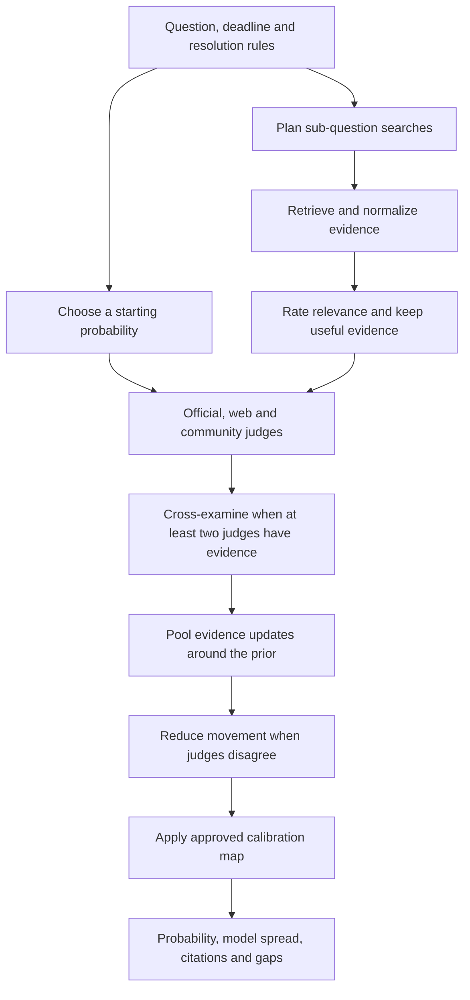

# Cassandra 1.1

Cassandra is a research workspace for forecasting **Yes/No events**. Define a question and resolution rules, collect evidence, ask several models to assess it, and inspect the resulting probability together with its sources and reasoning.

It combines a React web app, a TypeScript orchestration API and a Python judge service. Forecasts are stored as inspectable traces; historical evaluation and calibration help measure and improve them after outcomes are known. This is a working research prototype, not a demonstrated forecasting edge. The displayed range measures model spread, not a validated confidence interval.

- [Quick start](#quick-start)
- [Live mode](#live-mode-and-costs)
- [Solution architecture](#solution-architecture)
- [How predictions work](#how-predictions-work)
- [Evaluation and learning](#evaluation-and-learning)
- [User guide](docs/user-guide.md) · [Current state and verification](docs/current-status.md) · [HTTP API](docs/api-reference.md)

## Quick start

Use native Node/Python processes with Docker for Postgres and Redis. Prerequisites: **Node.js 22+, pnpm 10+, Python 3.12+, uv, Docker and Docker Compose**. The repository pins pnpm in `package.json`. Commands below use a POSIX-compatible shell such as bash or zsh and start from the repository root.

### 1. Install and configure a free fixture run

```bash
# Do not overwrite an existing local configuration.
test -f .env || cp .env.example .env
pnpm install --frozen-lockfile
pnpm --filter @cassandra/shared build
(cd services/judge && uv sync --frozen)
```

Edit these three entries in `.env` before starting services:

```dotenv
CASSANDRA_ADAPTER_MODE=fixture
CASSANDRA_JUDGE_LLM=fake
CASSANDRA_DISCOVERY_SCHEDULE=off
```

Fixture evidence and the fake judge are deterministic and need no paid provider keys. `.env.example` defaults to **live evidence**, so copying it without making this change is not an offline setup. Keep `.env` private and shell-compatible; quote values containing spaces or shell characters.

### 2. Start infrastructure and apply the schema

```bash
# Export configuration for native processes; do not print its contents.
set -a
. ./.env
set +a

docker compose up -d postgres redis
pnpm db:migrate
```

The schema is applied idempotently to the configured database. The migration script uses local `psql` when available and otherwise falls back to the Compose Postgres service. For a custom database, make sure it exists and that `DATABASE_URL` and `POSTGRES_DB` identify the intended target before migrating.

### 3. Run the judge in terminal A

From the repository root:

```bash
set -a
. ./.env
set +a
cd services/judge
uv run uvicorn app.main:app --host 127.0.0.1 --port "${JUDGE_PORT:-8000}" --reload
```

### 4. Run the API and web app in terminal B

From the repository root:

```bash
set -a
. ./.env
set +a
pnpm dev
```

`pnpm dev` starts the API and web app; **the judge runs separately**. Native startup commands do not automatically load the root `.env`, so export it in each terminal as shown. Stop a foreground process with Ctrl+C.

| Service | Default local address | Check |
| --- | --- | --- |
| Web workspace | http://localhost:5173 | Open Events or Help |
| API | http://127.0.0.1:3000 | `curl -fsS http://127.0.0.1:3000/ready` |
| Judge | http://127.0.0.1:8000 | `curl -fsS http://127.0.0.1:8000/health` |
| Postgres / Redis | localhost:5432 / localhost:6379 | `docker compose ps` |

### 5. Make your first forecast

1. Open **Events → Create event**. Write one Yes/No question, a deadline, entities and clear resolution criteria.
2. Save it, open the event and choose **Run judgment**. Creating an event alone does not run models.
3. Wait for queued → running → completed, then inspect the trace: probability, prior, model readings, citations and evidence gaps.
4. When the event resolves, record its actual outcome and source on the event page.

The first run in fixture mode demonstrates the workflow, not a real forecast. **Help** and expandable guidance on each screen explain the terms. Historical benchmark imports appear in **Evaluation**, not Events; an empty Events page does not mean an import failed.

## Live mode and costs

For real evidence and model calls, edit `.env`, replace the relevant provider placeholders, then restart the native API/judge processes with the updated environment:

```dotenv
CASSANDRA_ADAPTER_MODE=live
CASSANDRA_JUDGE_LLM=openrouter
CASSANDRA_DISCOVERY_SCHEDULE=off
CASSANDRA_SEARCH_BACKEND=openrouter
```

Configure `OPENROUTER_API_KEY` and any enabled provider keys, such as `PERPLEXITY_API_KEY`. Setting the search backend explicitly avoids selecting Z.AI just because its placeholder key is present. Use `zai` only with a valid `ZAI_API_KEY`. Remove unused optional provider placeholders or configure those providers before relying on their coverage.

**Live mode in the sidebar describes evidence adapters, not the judge backend.** The judge needs `CASSANDRA_JUDGE_LLM=openrouter` and a nonempty OpenRouter key. Models and reasoning effort live in the `OPENROUTER_*` environment variables; see [.env.example](.env.example) and the [forecasting methods note](docs/research/2026-11-07-llm-forecasting-methods.md). This README does not pin a separate model list.

Live judgments, discovery and model replay baselines incur provider charges. Scheduled watchlist discovery is on by default; leave `CASSANDRA_DISCOVERY_SCHEDULE=off` until you intend to run it. Browsing saved traces and Help does not launch predictions. Do not run paid harnesses as routine build checks.

## Solution architecture



| Component | Responsibility | Source |
| --- | --- | --- |
| Web | Events, watchlists, traces, runtime, evaluation, calibration and Help; strict response parsing and polling | `apps/web` |
| API + workers | Validation, evidence collection, queues, persistence, schedules and replay orchestration; workers currently run in the API process | `apps/api` |
| Judge | Query planning, relevance rating, prior selection, multi-model reasoning, aggregation and calibration fitting | `services/judge` |
| Shared contracts | Zod schemas, exported JSON Schema and generated Python models | `packages/shared` |
| Postgres | Events, immutable evidence, judgments, outcomes, calibration snapshots and benchmark forecasts | `apps/api/src/db` |
| Redis | BullMQ work queues, discovery schedules and caches | `apps/api/src/lib/queue.ts` |
| Harnesses | Live end-to-end exercise and an explicitly confirmed calibration cycle | `scripts/harness` |

The browser calls the API; provider credentials stay in backend configuration. Optional API-key access control is a shared operator key, not user accounts or tenant isolation. The API binds to loopback by default and checks browser origins. `VITE_API_KEY`, if configured, is visible to anyone who can load the web app. The judge has no authentication of its own.

### A judgment request



Failures and partial coverage are recorded in the trace/log rather than hidden. `completed` means processing finished, not that the event has resolved or the prediction is accurate.

## How predictions work



1. **Starting probability:** use the explicitly bound market price when available, otherwise the observed base rate for similar events, otherwise a model estimate without evidence. A related market returned by search cannot set the prior.
2. **Evidence:** official, government, web, community and market adapters gather sources. Relevance filtering removes weak matches. Source family follows the publisher, not the search provider's label.
3. **Judge panel:** official records, open web research and community signal are roles, each potentially backed by several models. A role with no evidence is neutral; failed model calls can abstain. Inconsistent samples can be excluded.
4. **Combination:** evidence-strength readings become log-odds updates around the prior, adjusted for learned weights, source overlap and freshness. Disagreement pulls the result back toward the prior. This is not a simple average of model percentages.
5. **Calibration and explanation:** the active approved snapshot may adjust the probability. With an identity map, the probability is unchanged. Every saved trace exposes sources, intermediate readings, gaps and pipeline stages. The range reflects model spread, not a statistically validated confidence interval.

## Evaluation and learning

**Evaluation** imports resolved Polymarket markets and replays selected cutoffs before their scheduled end dates. Baselines include base rate only, Polymarket only, model without Polymarket and model with Polymarket. Paired comparisons use the same market/cutoff sample. Lower Brier score is better; a negative difference from Polymarket favors the other baseline. Intervals group horizons by market.

Runs are queued and save each market's forecasts as it finishes. A failed run can resume using stored forecasts. Re-importing a benchmark set preserves historical forecasts. Replay uses today's search with date filters, so it does not recreate a complete historical information environment.

**Calibration** learns from resolved live judgments and, by default, stored replay forecasts. Multiple horizons of one market count as one group. Fewer than 20 resolved groups retain an identity map; market trust has a separate 40-market minimum. Retraining creates a candidate snapshot. Only the newest approved snapshot affects future judgments, and a non-identity map without demonstrated held-out improvement requires an explicit approval override. See the [user guide](docs/user-guide.md#record-outcomes-and-retrain) for the full workflow.

From a shell with `.env` exported:

```bash
pnpm harness:calibration                         # Free: print the plan only
CALIBRATION_CONFIRM=yes pnpm harness:calibration # Paid: import, replay and retrain
# Resume an existing run without importing again:
CALIBRATION_CONFIRM=yes CALIBRATION_RUN_ID="YOUR_RUN_ID" pnpm harness:calibration
# Separate paid end-to-end judgment exercise:
pnpm harness:real
```

The calibration harness never approves a snapshot. Default limits and options are documented at the top of `scripts/harness/calibration-cycle.mts`; defaults request 30 markets and allow up to 240 model forecast requests, each of which can call multiple models. Actual imports can be smaller.

## Current project state

As of **2026-11-11**, the workspace supports live queued judgments, watchlist discovery, evidence traces, resumable evaluation, grouped calibration training and in-app help. A paid local exercise imported 15 benchmark markets, stored 149 predictions and produced 47 eligible training forecasts across 13 market groups—still below the non-identity calibration threshold. Three separate open events also completed live predictions. These are dated local observations, not data shipped with the repo or proof of accuracy.

The prototype still has shared-key access control, no generated OpenAPI document, no configured linter and no committed browser end-to-end suite. The development Redis container disables persistence, so do not treat it as a durable production queue. The optional full Compose app profile is development scaffolding: its web API URL currently uses the container hostname `api`, which a host browser normally cannot resolve; prefer the native quick start above. See [current-status.md](docs/current-status.md) for evidence, limitations and remaining work.

## Development and verification

| Command | Purpose |
| --- | --- |
| `pnpm dev` | API and web; run the judge separately |
| `pnpm build` | Type-check and build workspace packages |
| `pnpm test` | Shared, API and web tests |
| `pnpm --filter @cassandra/web test` | Web tests only |
| `cd services/judge && uv run pytest` | Judge tests |
| `pnpm exec vitest run scripts/harness/real-e2e-support.test.ts scripts/harness/calibration-cycle.test.ts` | Harness unit tests |
| `pnpm db:migrate` / `pnpm db:migrate-test` | Apply the idempotent schemas |
| `pnpm lint` | Currently a no-op; no linter is configured |

API tests require local Postgres and Redis. Their pretest step migrates the dev and test databases; the tests **truncate tables in `cassandra_test`**. Never point the test configuration at data you need to retain.

After changing shared schemas, build `@cassandra/shared` and run `services/judge/scripts/generate-models.sh`. Do not hand-edit generated models or `dist/`. See [AGENTS.md](AGENTS.md) for repository conventions.

## Documentation

- [User guide](docs/user-guide.md)
- [Current state, live evidence and verification](docs/current-status.md)
- [HTTP API reference](docs/api-reference.md)
- [Forecasting methods and model configuration](docs/research/2026-11-07-llm-forecasting-methods.md)
- [Architecture review and remediation](docs/reviews/2026-11-07-architecture-and-algorithms-review.md)
- [Original solution design](docs/designs/2026-04-11-multisource-forecast-judge-solution-design.md)
- [Original implementation plan](docs/plans/2026-04-11-multisource-forecast-judge-implementation-plan.md)
