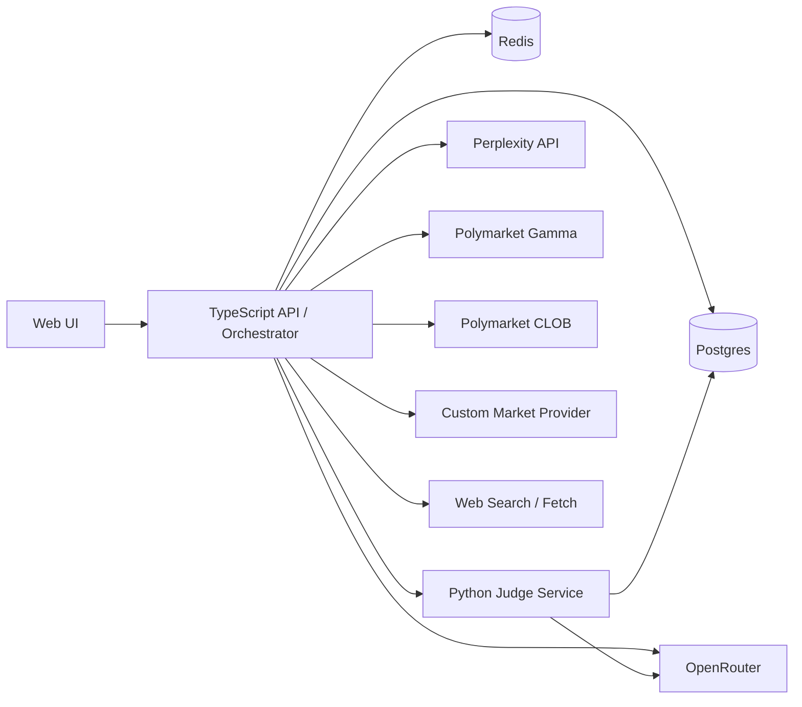

# Multi-Source Forecast Judge Solution Design

**Status:** Draft v1
**Date:** 2026-04-11
**Product Codename:** Cassandra
**Scope:** Local-Docker research prototype

## 1. Summary

Cassandra is a research system for producing traceable probability judgments about future events using multiple evidence families: public web sources, official and government publications, community discussions, traditional market signals, and prediction markets. The system does not rely on a single LLM verdict. Instead, it combines a panel of specialized judges with explicit mathematical aggregation and post-hoc calibration.

The v1 product is a hybrid monorepo with:

- a TypeScript orchestration API
- a Python judging service
- a minimal web UI for inspection
- Postgres for durable storage
- Redis for background jobs and caching
- Docker Compose for local operation

The primary output is a `VerdictTrace`: a full record of the event definition, evidence set, judge opinions, weights, conflicts, calibration metadata, citations, and final probability.

## 2. Goals

- Accept explicit forecast questions and topic watchlists.
- Discover, collect, normalize, and store evidence from multiple source families.
- Produce a probability estimate for a clearly phrased event by a deadline.
- Preserve a full audit trail of how the system reached the estimate.
- Support historical backtesting, calibration, and weight updates from resolved outcomes.
- Keep the v1 architecture simple enough to run locally while preserving production-ready boundaries.

## 3. Non-Goals

- No direct end-user public product in v1.
- No multi-tenant auth, billing, or account system.
- No autonomous publishing or notification workflows.
- No direct Reddit or X API integrations in v1; community evidence comes from search-discovered public URLs.
- No fully automated event promotion from watchlists; discovery is automatic, approval remains manual.
- No live trading or order placement against Polymarket.

## 4. Primary User Journeys

### 4.1 Explicit event workflow

1. Operator submits an event with question, resolution criteria, deadline, entities, and optional market identifiers.
2. API schedules an evidence collection job.
3. Adapters retrieve web, official, government, community, market, and Polymarket evidence.
4. Normalization and deduplication build a canonical evidence set.
5. Python judge service runs specialized judges plus cross-examination.
6. Aggregation and calibration produce the final probability and confidence band.
7. UI displays the trace, disagreements, and supporting citations.

### 4.2 Watchlist workflow

1. Operator creates a watchlist for a topic, geography, or entity set.
2. Discovery jobs collect candidate signals from web/community/official channels.
3. Candidate events are clustered and normalized into event hypotheses.
4. Operator promotes a candidate into a tracked event.
5. The explicit event workflow runs against the promoted event.

### 4.3 Learning loop workflow

1. Operator records the real-world outcome of a resolved event.
2. Backtest pipeline compares predicted probability against outcome.
3. System computes per-judge and aggregate metrics such as Brier score and log loss.
4. A new calibration snapshot is produced and versioned.
5. Future judgments use the latest approved calibration snapshot.

## 5. System Overview



### 5.1 Component responsibilities

- `apps/api`
  - event and watchlist CRUD
  - evidence collection orchestration
  - adapter execution
  - normalization and persistence
  - background job scheduling
  - integration with the judge service
- `services/judge`
  - judge-specific reasoning
  - mathematical aggregation
  - confidence-band generation
  - calibration and backtesting logic
- `apps/web`
  - event submission
  - watchlist management
  - candidate promotion
  - verdict trace inspection
- `packages/shared`
  - shared JSON schemas and TypeScript types for payloads

## 6. Technical Architecture

### 6.1 Repo structure

```text
.
|-- apps/
|   |-- api/
|   `-- web/
|-- services/
|   `-- judge/
|-- packages/
|   `-- shared/
|-- docs/
|   |-- designs/
|   `-- plans/
|-- docker-compose.yml
|-- .env.example
`-- README.md
```

### 6.2 Runtime model

- API and web app are managed as `pnpm` workspace packages.
- Judge service is managed with `uv` and FastAPI.
- Postgres stores all durable records, including raw evidence, traces, outcomes, and calibration snapshots.
- Redis backs job queues and short-lived caching for expensive retrieval steps.
- Docker Compose runs Postgres, Redis, API, judge service, and web app locally.

### 6.3 Why this split

The system needs strong orchestration and convenient web integration on the TypeScript side, while the judge and calibration logic fit Python better due to ecosystem support for numerical methods and model evaluation. The split keeps the mathematical core explicit and testable without forcing all adapters into Python.

## 7. Evidence Model

Every adapter produces a normalized `EvidenceItem` with this conceptual shape:

```json
{
  "id": "uuid",
  "eventId": "uuid",
  "sourceFamily": "official|government|community|web|market|prediction_market|llm_research",
  "sourceType": "perplexity_search_result|web_article|reddit_post|x_post|sec_filing|press_release|polymarket_market|quote_snapshot",
  "title": "string",
  "url": "string",
  "publisher": "string",
  "publishedAt": "ISO-8601",
  "retrievedAt": "ISO-8601",
  "summary": "string",
  "rawText": "string|null",
  "entities": ["string"],
  "claims": ["string"],
  "stance": "supports|contradicts|neutral|unknown",
  "freshnessHours": 12.5,
  "qualitySignals": {
    "officialDomain": true,
    "governmentDomain": false,
    "duplicateClusterSize": 3,
    "citationCount": 2
  },
  "metadata": {}
}
```

### 7.1 Source-family rules

- `official`
  - company IR pages
  - official statements
  - press releases
  - first-party blogs
- `government`
  - `.gov`, `.europa.eu`, public agencies, courts, regulators
- `community`
  - search-discovered public Reddit and X URLs
- `web`
  - news articles, trade press, research blogs
- `market`
  - quotes, candles, news, derived price moves from the custom market provider
- `prediction_market`
  - Polymarket market metadata, price history, spreads, volume, comments if used
- `llm_research`
  - Perplexity research outputs and search summaries

### 7.2 Normalization rules

- Deduplicate by canonical URL plus fuzzy title hash.
- Cluster near-identical news rewrites into one group.
- Preserve raw material but judge on normalized summaries and extracted claims.
- Record freshness at retrieval time so late re-scoring does not lose temporal context.
- Apply source-family-specific quality signals rather than one global trust score.

## 8. Judging Pipeline

### 8.1 Stage 1: Event canonicalization

Inputs are normalized into:

- clear binary question
- deadline
- resolution criteria
- entity set
- optional linked symbols and market IDs

If the question is vague or lacks resolvable criteria, the system returns a validation error instead of proceeding.

### 8.2 Stage 2: Evidence retrieval

The API orchestrator collects evidence from:

- Perplexity for fast multi-source research
- public web search and fetch for citations and raw content
- domain-constrained official and government searches
- community search over public Reddit and X URLs
- Polymarket Gamma for discovery and metadata
- Polymarket CLOB for pricing and price history
- custom market provider for equities and crypto quotes/news

### 8.3 Stage 3: Judge panel

The judge service runs a fixed panel:

- `market_prior`
  - converts market and prediction-market signals into a prior probability
- `official_records`
  - focuses on official, government, and regulatory evidence
- `community_signal`
  - measures narrative momentum, rumor density, and contradiction patterns
- `open_web_research`
  - synthesizes broad web reporting and corroboration patterns
- `cross_examiner`
  - attacks the other judges' conclusions, identifies unsupported leaps, and recommends penalties

Each judge returns:

- `probability`
- `confidence`
- `rationale`
- `evidenceIds`
- `warnings`
- `missingEvidence`

### 8.4 Stage 4: Mathematical aggregation

The aggregation layer is explicit and reproducible:

1. Convert judge probabilities into log-odds.
2. Apply base judge weights from the latest calibration snapshot.
3. Apply evidence-quality modifiers.
4. Apply freshness decay where older evidence contributes less.
5. Apply disagreement penalties when the cross-examiner identifies unsupported divergence.
6. Clamp extreme values from any single judge to avoid domination.
7. Convert combined log-odds back to probability.

Conceptual formula:

```text
final_log_odds =
  prior_log_odds
  + sum(judge_weight_j * evidence_quality_j * freshness_decay_j * opinion_log_odds_j)
  - contradiction_penalty
  - uncertainty_penalty
```

### 8.5 Stage 5: Calibration

Raw probability is not the final answer. A calibration layer fits historical predicted probabilities against actual outcomes. For v1:

- store outcome labels as binary values
- compute Brier score and log loss per judge and aggregate
- fit a simple monotonic calibrator or logistic calibration model
- version the resulting calibration snapshot
- include `weightVersion` and `calibrationVersion` in every verdict

### 8.6 Stage 6: Confidence band

The confidence band should reflect:

- amount of corroborated evidence
- evidence-family diversity
- judge agreement
- recency
- calibration quality on similar historical events

The band is not a separate forecast. It is an uncertainty envelope around the final probability.

## 9. Data Model

### 9.1 Core entities

#### `Event`

- `id`
- `question`
- `resolutionCriteria`
- `deadline`
- `status`
- `entities`
- `marketSymbols`
- `polymarketMarketId`
- `createdAt`
- `updatedAt`

#### `Watchlist`

- `id`
- `name`
- `keywords`
- `jurisdictions`
- `cadence`
- `sourceToggles`
- `status`

#### `CandidateEvent`

- `id`
- `watchlistId`
- `title`
- `description`
- `supportingEvidenceIds`
- `clusterKey`
- `promotionStatus`

#### `EvidenceItem`

- normalized content plus source metadata and quality signals

#### `JudgeOpinion`

- `id`
- `judgmentId`
- `judgeName`
- `probability`
- `confidence`
- `rationale`
- `evidenceIds`
- `warnings`

#### `VerdictTrace`

- `id`
- `eventId`
- `finalProbability`
- `confidenceLow`
- `confidenceHigh`
- `judgeOpinions`
- `weightBreakdown`
- `conflicts`
- `missingEvidence`
- `citations`
- `modelVersion`
- `weightVersion`
- `calibrationVersion`
- `status`

#### `Outcome`

- `id`
- `eventId`
- `resolvedValue`
- `resolvedAt`
- `resolutionSourceUrl`

#### `CalibrationSnapshot`

- `id`
- `createdAt`
- `trainingWindow`
- `judgeWeights`
- `calibrationParams`
- `metrics`
- `approved`

### 9.2 Storage strategy

- relational columns for queryable identifiers and lifecycle status
- JSONB for flexible evidence payloads, judge rationale, and traces
- append-only trace history so reruns are never destructive

## 10. API Design

### 10.1 Events

`POST /events`

```json
{
  "question": "Will company X receive approval for product Y by 2026-12-31?",
  "resolutionCriteria": "Counts only if regulator Z publishes final approval on its official site.",
  "deadline": "2026-12-31T23:59:59Z",
  "entities": ["company X", "product Y", "regulator Z"],
  "marketSymbols": ["XYZ"],
  "polymarketMarketId": "optional"
}
```

`GET /events/:id`

Returns event metadata and the latest judgment summary.

### 10.2 Watchlists

`POST /watchlists`

```json
{
  "name": "EU AI regulation",
  "keywords": ["EU AI Act", "Brussels AI enforcement", "foundation model fines"],
  "jurisdictions": ["EU"],
  "cadence": "6h",
  "sourceToggles": {
    "community": true,
    "official": true,
    "government": true,
    "markets": true
  }
}
```

`GET /watchlists/:id/candidates`

Returns discovered candidate events and supporting evidence.

### 10.3 Judgments

`POST /judgments`

```json
{
  "eventId": "uuid",
  "forceRefresh": false
}
```

`GET /judgments/:id`

Returns the full `VerdictTrace`.

### 10.4 Outcomes and backtests

`POST /outcomes`

```json
{
  "eventId": "uuid",
  "resolvedValue": true,
  "resolvedAt": "2026-11-12T12:00:00Z",
  "resolutionSourceUrl": "https://example.gov/decision"
}
```

`POST /backtests/retrain`

Triggers recalibration from stored outcomes.

## 11. UI Design

The web UI is operator-facing and intentionally thin.

### 11.1 Screens

- event list
- event detail with latest probability and trend
- watchlist list
- watchlist candidate review
- judgment trace view
- calibration snapshot history

### 11.2 Trace view requirements

The trace page must show:

- final probability and confidence band
- source-family breakdown
- timeline of evidence items
- judge cards with rationale and cited evidence
- explicit conflict list
- calibration metadata
- rerun action

The UI must not invent logic. It renders server-returned trace structures directly.

## 12. Configuration

Required environment variables:

- `DATABASE_URL`
- `REDIS_URL`
- `PERPLEXITY_API_KEY`
- `OPENROUTER_API_KEY`
- `OPENROUTER_JUDGE_MODEL`
- `OPENROUTER_CROSS_EXAMINER_MODEL`
- `POLYMARKET_GAMMA_URL`
- `POLYMARKET_CLOB_URL`
- `CUSTOM_MARKET_API_BASE_URL`
- `CUSTOM_MARKET_API_KEY`

Optional:

- domain allowlists for official and government search
- queue concurrency values
- adapter timeouts
- calibration retraining cadence

## 13. Reliability And Safety

- Treat all external content as untrusted input.
- Record every citation used in a judgment.
- Mark insufficient-evidence cases explicitly instead of forcing a confident answer.
- Prevent a single evidence family from dominating the score without corroboration.
- Keep raw retrieval outputs for debugging, but only normalized evidence should influence the final aggregation.
- Apply strict timeouts and retries around external adapters.

## 14. Risks And Mitigations

### 14.1 Community-source noise

Risk:
public community sources amplify rumors and copied claims.

Mitigation:
community judge weight is capped and requires corroboration for large directional impact.

### 14.2 API fragility

Risk:
external providers change payloads or rate limits.

Mitigation:
adapter-level contract tests with recorded fixtures and explicit provider boundaries.

### 14.3 False precision

Risk:
probabilities appear more precise than the evidence supports.

Mitigation:
confidence band, disagreement penalties, and `insufficient_evidence` status.

### 14.4 Calibration drift

Risk:
historical weights become stale as source behavior changes.

Mitigation:
versioned calibration snapshots and periodic retraining from recent outcomes.

## 15. Success Criteria

The v1 prototype is successful when:

- an operator can create an event and receive a full verdict trace locally
- a watchlist can discover candidate events and support manual promotion
- the judge service combines multiple evidence families into one reproducible probability
- resolved outcomes can be recorded and used to generate a new calibration snapshot
- the trace clearly shows why the system believed what it believed

## 16. Assumptions

- English-first only.
- Local Docker is the primary deployment target.
- Perplexity is the default retrieval and citation-oriented research backend.
- OpenRouter is the default LLM gateway for judge and cross-examiner models.
- Polymarket public APIs are used only for public market information, not trading.
- Traditional market data comes from an existing provider already available to the operator.
