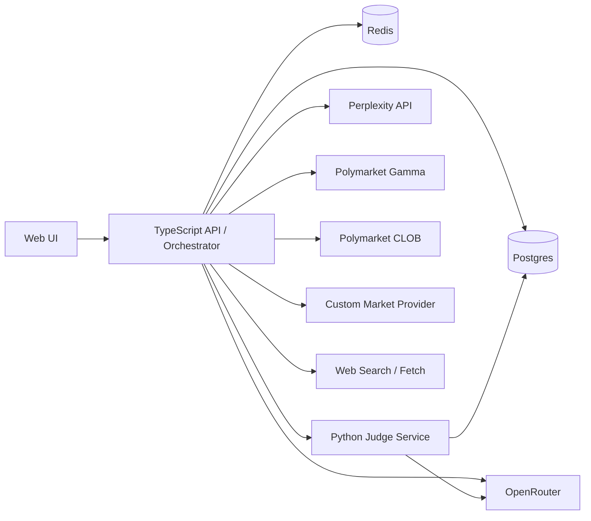

# Multi-Source Forecast Judge Solution Design

**Status:** Draft v1
**Date:** 2026-04-11
**Product Codename:** Cassandra
**Scope:** Local-Docker research prototype

## 1. Summary

Cassandra is a research system for producing traceable probability judgments about future events using multiple evidence families: public web sources, official and government publications, community discussions, traditional market signals, and prediction markets. The system does not rely on a single LLM verdict. Instead, it combines a panel of specialized judges with explicit mathematical aggregation and post-hoc calibration.

Mathematically, the v1 system is grounded in Bayesian updating, reference-class forecasting, prediction-market priors, logarithmic opinion pooling, proper scoring rules, online expert weighting, and bootstrap-based uncertainty estimation. The goal is not to let the LLM invent the math. The goal is to force every forecast through a reproducible probabilistic pipeline.

The v1 product is a hybrid monorepo with:

- a TypeScript orchestration API
- a Python judging service
- a minimal web UI for inspection
- Postgres for durable storage
- Redis for background jobs and caching
- Docker Compose for local operation

The primary output is a `VerdictTrace`: a full record of the event definition, evidence set, judge opinions, weights, conflicts, calibration metadata, citations, and final probability.

## 2. Goals

- Accept explicit forecast questions and topic watchlists.
- Discover, collect, normalize, and store evidence from multiple source families.
- Produce a probability estimate for a clearly phrased event by a deadline.
- Preserve a full audit trail of how the system reached the estimate.
- Support historical backtesting, calibration, and weight updates from resolved outcomes.
- Keep the v1 architecture simple enough to run locally while preserving production-ready boundaries.

## 3. Non-Goals

- No direct end-user public product in v1.
- No multi-tenant auth, billing, or account system.
- No autonomous publishing or notification workflows.
- No direct Reddit or X API integrations in v1; community evidence comes from search-discovered public URLs.
- No fully automated event promotion from watchlists; discovery is automatic, approval remains manual.
- No live trading or order placement against Polymarket.

## 4. Primary User Journeys

### 4.1 Explicit event workflow

1. Operator submits an event with question, resolution criteria, deadline, entities, and optional market identifiers.
2. API schedules an evidence collection job.
3. Adapters retrieve web, official, government, community, market, and Polymarket evidence.
4. Normalization and deduplication build a canonical evidence set.
5. Python judge service runs specialized judges plus cross-examination.
6. Aggregation and calibration produce the final probability and confidence band.
7. UI displays the trace, disagreements, and supporting citations.

### 4.2 Watchlist workflow

1. Operator creates a watchlist for a topic, geography, or entity set.
2. Discovery jobs collect candidate signals from web/community/official channels.
3. Candidate events are clustered and normalized into event hypotheses.
4. Operator promotes a candidate into a tracked event.
5. The explicit event workflow runs against the promoted event.

### 4.3 Learning loop workflow

1. Operator records the real-world outcome of a resolved event.
2. Backtest pipeline compares predicted probability against outcome.
3. System computes per-judge and aggregate metrics such as Brier score and log loss.
4. A new calibration snapshot is produced and versioned.
5. Future judgments use the latest approved calibration snapshot.

## 5. System Overview



### 5.1 Component responsibilities

- `apps/api`
  - event and watchlist CRUD
  - evidence collection orchestration
  - adapter execution
  - normalization and persistence
  - background job scheduling
  - integration with the judge service
- `services/judge`
  - judge-specific reasoning
  - mathematical aggregation
  - confidence-band generation
  - calibration and backtesting logic
- `apps/web`
  - event submission
  - watchlist management
  - candidate promotion
  - verdict trace inspection
- `packages/shared`
  - shared JSON schemas and TypeScript types for payloads

## 6. Technical Architecture

### 6.1 Repo structure

```text
.
|-- apps/
|   |-- api/
|   `-- web/
|-- services/
|   `-- judge/
|-- packages/
|   `-- shared/
|-- docs/
|   |-- designs/
|   `-- plans/
|-- docker-compose.yml
|-- .env.example
`-- README.md
```

### 6.2 Runtime model

- API and web app are managed as `pnpm` workspace packages.
- Judge service is managed with `uv` and FastAPI.
- Postgres stores all durable records, including raw evidence, traces, outcomes, and calibration snapshots.
- Redis backs job queues and short-lived caching for expensive retrieval steps.
- Docker Compose runs Postgres, Redis, API, judge service, and web app locally.

### 6.3 Why this split

The system needs strong orchestration and convenient web integration on the TypeScript side, while the judge and calibration logic fit Python better due to ecosystem support for numerical methods and model evaluation. The split keeps the mathematical core explicit and testable without forcing all adapters into Python.

## 7. Evidence Model

Every adapter produces a normalized `EvidenceItem` with this conceptual shape:

```json
{
  "id": "uuid",
  "eventId": "uuid",
  "sourceFamily": "official|government|community|web|market|prediction_market|llm_research",
  "sourceType": "perplexity_search_result|web_article|reddit_post|x_post|sec_filing|press_release|polymarket_market|quote_snapshot",
  "title": "string",
  "url": "string",
  "publisher": "string",
  "publishedAt": "ISO-8601",
  "retrievedAt": "ISO-8601",
  "summary": "string",
  "rawText": "string|null",
  "entities": ["string"],
  "claims": ["string"],
  "stance": "supports|contradicts|neutral|unknown",
  "qualitySignals": {
    "officialDomain": true,
    "governmentDomain": false,
    "duplicateClusterSize": 3,
    "citationCount": 2
  },
  "metadata": {}
}
```

### 7.1 Source-family rules

- `official`
  - company IR pages
  - official statements
  - press releases
  - first-party blogs
- `government`
  - `.gov`, `.europa.eu`, public agencies, courts, regulators
- `community`
  - search-discovered public Reddit and X URLs
- `web`
  - news articles, trade press, research blogs
- `market`
  - quotes, candles, news, derived price moves from the custom market provider
- `prediction_market`
  - Polymarket market metadata, price history, spreads, volume, comments if used
- `llm_research`
  - Perplexity research outputs and search summaries

### 7.2 Normalization rules

- Deduplicate by canonical URL plus fuzzy title hash.
- Cluster near-identical news rewrites into one group.
- Preserve raw material but judge on normalized summaries and extracted claims.
- Persist `publishedAt` verbatim and never pre-compute freshness at ingest time. Freshness is derived at aggregation time as `evaluationTime - publishedAt`, where `evaluationTime` is the wall clock in live mode and the replay cutoff in backtest mode. This keeps the same evidence row usable across historical replay cutoffs without mutation.
- Apply source-family-specific quality signals rather than one global trust score.

## 8. Judging Pipeline

### 8.1 Stage 1: Event canonicalization

Inputs are normalized into:

- clear binary question
- deadline
- resolution criteria
- entity set
- optional linked symbols and market IDs

If the question is vague or lacks resolvable criteria, the system returns a validation error instead of proceeding.

### 8.2 Stage 2: Evidence retrieval

The API orchestrator collects evidence from:

- Perplexity for fast multi-source research
- public web search and fetch for citations and raw content
- domain-constrained official and government searches
- community search over public Reddit and X URLs
- Polymarket Gamma for discovery and metadata
- Polymarket CLOB for pricing and price history
- custom market provider for equities and crypto quotes/news

### 8.3 Stage 3: Judge panel

The judge service runs a fixed panel. Market and prediction-market signals are intentionally excluded from the judge panel and routed through the prior step instead (§8.5). This prevents the same market information from being double-counted as both a prior and a likelihood update under log-opinion pooling.

The three evidence-reading judges:

- `official_records`
  - focuses on official, government, and regulatory evidence
- `community_signal`
  - measures narrative momentum, rumor density, and contradiction patterns
- `open_web_research`
  - synthesizes broad web reporting and corroboration patterns

Plus one meta-judge:

- `cross_examiner`
  - reads the other judges' opinions and flags unsupported leaps, missing corroboration, internal contradictions, and evidence over-reach
  - produces a structured `conflicts` list and per-judge `warnings`; it does not emit a scalar penalty
  - the aggregator converts judge dispersion into a quantitative contradiction penalty independently (§8.5); the cross-examiner provides the qualitative trace that explains *why* judges disagreed

Each evidence-reading judge returns a raw opinion (§8.3.1). The aggregator then derives the finalized `JudgeOpinion` object that ends up in the trace, including `logBayesFactor`, `reliabilityWeight`, `dependencyDiscount`, and `freshnessDecay`.

### 8.3.1 Judge output protocol

LLM-backed judges produce poorly calibrated scalars when asked directly for log Bayes factors: the output distribution collapses to a few favored values. v1 uses an ordinal `evidenceStrength` Likert with a fixed monotonic mapping to bounded log BFs.

Each evidence-reading judge returns:

- `probability` — sanity-check value used for display and dispersion only
- `evidenceStrength` — one of `strong_against`, `moderate_against`, `weak_against`, `neutral`, `weak_for`, `moderate_for`, `strong_for`
- `rationale` — free text explaining the choice
- `evidenceIds` — the evidence items actually used
- `warnings` — free text list of caveats
- `missingEvidence` — structured list of evidence the judge expected but could not find

The aggregator maps `evidenceStrength` to a bounded log Bayes factor using a fixed table:

```text
strong_against    -> -3.0
moderate_against  -> -1.5
weak_against      -> -0.5
neutral           ->  0.0
weak_for          -> +0.5
moderate_for      -> +1.5
strong_for        -> +3.0
```

The table is intentionally coarse and symmetric. Mapping values can be tuned by calibration once enough resolved outcomes exist, but the v1 defaults above are used until the calibration regime allows learned overrides (§8.5).

Benefits:

- judge outputs are naturally bounded, so no single judge can dominate the pool
- outputs are deterministic to test with fake LLMs
- the Likert level is what a calibrated human forecaster can reliably produce — LLMs match that grain better than they match a continuous log-BF

### 8.4 Forecasting theories used in v1

The mathematical core is based on a small set of explicit forecasting theories rather than a generic "weighted average" approach.

- **Reference-class forecasting**
  - Every event should start from a base-rate prior when a relevant historical class exists, such as regulatory approvals, election outcomes, product launches, or court decisions.
  - This reduces anchoring on the latest headlines and follows the forecasting principle that outside-view rates should constrain inside-view narratives.
  - v1 does not attempt automatic reference-class discovery. Operators pick a `referenceClass` from a curated taxonomy at event-creation time, and the base-rate table is seeded from 3–5 classes covering the initial benchmark themes. The starting taxonomy is:
    - `regulatory_approval_binary`
    - `election_binary_uncontested`
    - `product_launch_by_date`
    - `macro_release_threshold`
    - `geopolitical_event_binary`
  - When `referenceClass` is null or the selected class has fewer than a minimum sample threshold of historical outcomes, the system falls back to a global `Beta(1, 1)` prior and sets a `referenceClassFallback` flag on the trace. Automated class discovery is left for a later iteration.
- **Bayesian updating**
  - New evidence is treated as a likelihood update against a prior, not as a fresh forecast from scratch.
  - In implementation terms, each judge contributes a log Bayes factor or log-likelihood ratio rather than only a free-form probability.
- **Prediction-market theory**
  - Polymarket and traditional market signals are treated as noisy consensus priors.
  - Market prices are not assumed correct; they are liquidity- and spread-adjusted because thin markets and manipulated markets are less informative.
- **Logarithmic opinion pools**
  - Multi-judge aggregation uses log-opinion pooling in log-odds space instead of a plain arithmetic average.
  - This preserves probabilistic coherence better than linear averaging and makes judge contributions additive after transformation.
- **Proper scoring rules**
  - Brier score and logarithmic score are the main evaluation signals for judge quality, calibration quality, and rolling weight updates.
  - This keeps weight learning aligned with real probabilistic accuracy rather than narrative plausibility.
- **Online learning for forecaster weights**
  - Judge weights should evolve over time using exponentially weighted updates or similar regret-minimizing expert algorithms.
  - Judges that repeatedly forecast poorly lose influence without requiring hard-coded manual retuning.
- **Calibration theory**
  - Raw ensemble outputs are post-processed with monotonic calibration methods so predicted probabilities better match empirical frequencies.
  - For v1, isotonic regression is preferred when there is enough data; logistic or beta calibration is the fallback for smaller samples.
- **Uncertainty estimation**
  - Confidence bands are not hand-waved from "confidence" text. They are derived from forecast dispersion, evidence coverage, calibration quality, and bootstrap resampling.

### 8.5 Stage 4: Mathematical inference and aggregation

The aggregation layer is explicit and reproducible:

1. Construct a base-rate prior from the best available reference class.
2. Blend the base-rate prior with liquidity-adjusted market and prediction-market priors.
3. Convert each judge output into a log Bayes factor or log-odds contribution.
4. Map each judge's `evidenceStrength` to a bounded `log_bayes_factor_j` via the fixed table in §8.3.1.
5. Apply base judge weights from the latest calibration snapshot.
6. Apply evidence-quality modifiers, freshness decay, and dependency discounts (see §8.5.1).
7. Compute a disagreement shrinkage term from judge dispersion (see §8.5.2). The cross-examiner's structured output is attached to the trace but does not contribute a scalar.
8. Pool the adjusted opinions with a regularized logarithmic opinion pool.
9. Convert the pooled posterior log-odds back to raw probability.
10. Pass the raw probability through the latest approved calibration model.

Conceptual formula:

```text
prior_log_odds =
  alpha * logit(base_rate_prior)
  + (1 - alpha) * logit(liquidity_adjusted_market_prior)

raw_posterior_log_odds =
  prior_log_odds
  + sum(
      base_weight_j
      * dependency_discount_j
      * evidence_quality_j
      * freshness_decay_j
      * log_bayes_factor_j
    )

posterior_log_odds =
  (1 - shrinkage) * raw_posterior_log_odds

calibrated_probability = calibration_map(sigmoid(posterior_log_odds))
```

Where:

- `alpha` is the shrinkage term between outside-view and market-view priors. When the selected `referenceClass` has insufficient sample, `alpha` is set to 0 and the prior becomes market-only.
- `base_weight_j` is the per-judge weight from the latest calibration snapshot. In the cold-start regime (§8.5.3) all weights are uniform.
- `dependency_discount_j` reduces overweighting when judges rely on overlapping evidence (§8.5.1).
- `freshness_decay_j` follows an exponential forgetting curve `exp(-age_hours / half_life_hours)`, where `age_hours` is computed at aggregation time from `evaluationTime - publishedAt`.
- `evidence_quality_j` is a bounded multiplier aggregated from per-item quality signals (§7) and capped in `[0.5, 1.5]`.
- `shrinkage` is the disagreement shrinkage in `[0, 1)` (§8.5.2); higher dispersion pulls the posterior toward the prior rather than toward 0.5 of a raw probability scale, preserving prior signal while damping disputed updates.
- `calibration_map` is the learned monotonic post-processing function; in the cold-start regime it is the identity.

### 8.5.1 Dependency discount

Judges that read overlapping evidence should not count as independent votes. v1 computes the discount post-hoc from the evidence sets each judge actually cited:

```text
for each judge j:
  overlap_j = sum over k ≠ j of jaccard(evidenceIds_j, evidenceIds_k)
  n_eff_j   = 1 / (1 + overlap_j)
  dependency_discount_j = n_eff_j
```

The discount is bounded in `(0, 1]`. Two judges citing identical evidence end up with `dependency_discount ≈ 0.5` each, so their combined contribution approximates one independent judge. The matrix of pairwise Jaccard overlaps is persisted in the debug trace.

### 8.5.2 Disagreement shrinkage (contradiction handling)

The disagreement term is deterministic and computed from judge dispersion, not from the cross-examiner:

```text
log_odds_j = base_weight_j * log_bayes_factor_j   # per-judge, unweighted by discounts
dispersion = variance(log_odds_j across judges)
shrinkage  = clip(k_disagree * dispersion, 0, shrinkage_max)
```

Defaults for v1: `k_disagree = 0.25`, `shrinkage_max = 0.6`. Shrinkage pulls the posterior toward the prior rather than toward 0.5, which preserves prior signal while damping contested updates. The cross-examiner's role becomes qualitative — its structured `conflicts` and `warnings` are attached to the trace so operators can see *why* the shrinkage activated, but it does not tune the scalar.

### 8.5.3 Cold-start and data-volume regimes

Online expert weighting and calibration both require resolved outcomes. v1 defines three regimes, switched automatically by the number of resolved outcomes `N` covered by the latest snapshot:

| Regime | Condition | Judge weights | Calibration |
|---|---|---|---|
| `cold_start` | `N < 20` | uniform across judges, no online updates | identity (no remap) |
| `warming` | `20 ≤ N < 100` | exponentially weighted updates with step size halved | logistic or beta calibration |
| `steady` | `N ≥ 100` | full exponentially weighted updates | isotonic with logistic fallback |

The active regime is persisted as `weightRegime` on every `VerdictTrace`, so traces from different periods remain self-describing. The Likert→BF mapping table (§8.3.1) is frozen at its defaults in `cold_start` and `warming`; only `steady` may use learned overrides.

### 8.6 Selected algorithms for v1

The v1 implementation should use the following concrete algorithms:

- **Empirical-Bayes base-rate prior**
  - Use historical event frequencies where available and shrink sparse classes toward a global prior.
- **Liquidity-adjusted market prior**
  - Convert market prices to log-odds, then discount them by spread, depth, and recent volatility to reduce noise from thin markets.
- **Judge-level Bayes-factor mapping**
  - Every judge returns a bounded `logBayesFactor` in addition to a probability, so aggregation is mathematically interpretable.
- **Regularized log-opinion pool**
  - Combine judges in log-odds space with caps and dependency discounts.
- **Exponential recency weighting**
  - Use half-life based decay so older evidence loses force smoothly rather than via hard cutoffs.
- **Exponentially weighted expert updates**
  - Update judge weights over time according to recent proper-score regret.
- **Isotonic calibration with logistic fallback**
  - Prefer isotonic regression on larger outcome sets; use logistic calibration when the dataset is too small for stable isotonic fits.
- **Block bootstrap uncertainty bands**
  - Resample evidence clusters and judge subsets to estimate forecast spread without assuming independence.

### 8.7 Stage 5: Calibration

Raw probability is not the final answer. A calibration layer fits historical predicted probabilities against actual outcomes. For v1:

- store outcome labels as binary values
- compute Brier score and log loss per judge and aggregate
- compute reliability curves and calibration error by event family
- fit isotonic calibration when data volume allows
- fall back to logistic or beta calibration when the sample is small
- update rolling judge weights with exponentially weighted regret
- version the resulting calibration snapshot
- include `weightVersion` and `calibrationVersion` in every verdict

### 8.8 Stage 6: Confidence band

The confidence band should reflect:

- amount of corroborated evidence
- evidence-family diversity
- judge agreement
- recency
- calibration quality on similar historical events
- bootstrap dispersion across evidence clusters and judge subsets

The band is not a separate forecast. It is an uncertainty envelope around the final probability.

## 9. Data Model

### 9.1 Core entities

#### `Event`

- `id`
- `question`
- `resolutionCriteria`
- `deadline`
- `status`
- `entities`
- `referenceClass` (nullable; selected from the v1 taxonomy in §8.4)
- `marketSymbols`
- `polymarketMarketId`
- `createdAt`
- `updatedAt`

#### `Watchlist`

- `id`
- `name`
- `keywords`
- `jurisdictions`
- `cadence`
- `sourceToggles`
- `status`

#### `CandidateEvent`

- `id`
- `watchlistId`
- `title`
- `description`
- `supportingEvidenceIds`
- `clusterKey`
- `promotionStatus`

#### `EvidenceItem`

- normalized content plus source metadata and quality signals
- `publishedAt` is persisted verbatim; no pre-computed freshness field (see §7.2)

#### `JudgeOpinion`

The `JudgeOpinion` has two sets of fields: those produced by the LLM-backed judge, and those derived post-hoc by the aggregator. Both are persisted so the trace is self-explaining.

Judge-produced:

- `id`
- `judgmentId`
- `judgeName`
- `probability` (sanity-check display value)
- `evidenceStrength` (Likert ordinal, §8.3.1)
- `rationale`
- `evidenceIds`
- `warnings`
- `missingEvidence`

Aggregator-derived:

- `logBayesFactor` (mapped from `evidenceStrength` via the §8.3.1 table)
- `baseWeight` (from the active `CalibrationSnapshot`)
- `dependencyDiscount` (Jaccard-based, §8.5.1)
- `freshnessDecay` (aggregate of the judge's cited evidence ages at `evaluationTime`)
- `effectiveLogOddsContribution` (final pre-shrinkage contribution, for trace inspection)

#### `VerdictTrace`

- `id`
- `eventId`
- `evaluationTime` (wall clock in live mode, replay cutoff in backtest mode)
- `referenceClass` (snapshot of `Event.referenceClass` at evaluation time)
- `referenceClassFallback` (boolean; true when the class was null or under-sampled and `Beta(1, 1)` was used)
- `priorProbability`
- `rawPosteriorProbability`
- `finalProbability`
- `confidenceLow`
- `confidenceHigh`
- `judgeOpinions`
- `weightBreakdown`
- `dependencyMatrix` (per-judge pairwise Jaccard overlaps)
- `disagreementShrinkage` (computed scalar, §8.5.2)
- `ensembleMethod`
- `calibrationMethod`
- `uncertaintyMethod`
- `conflicts`: `Array<{ judgeA: string, judgeB: string, reason: string, severity: "low"|"medium"|"high" }>`
- `missingEvidence`: `Array<{ claim: string, sourceFamily: string, reason: string }>`
- `citations`
- `modelVersion`
- `weightVersion`
- `weightRegime` (`cold_start` | `warming` | `steady`, §8.5.3)
- `calibrationVersion`
- `replayFidelity` (`live` | `approximate`, for historical replay traces)
- `status`

#### `Outcome`

- `id`
- `eventId`
- `resolvedValue`
- `resolvedAt`
- `resolutionSourceUrl`

#### `CalibrationSnapshot`

- `id`
- `createdAt`
- `trainingWindow`
- `judgeWeights`
- `baseRateParams`
- `marketPriorParams`
- `calibrationParams`
- `onlineLearningParams`
- `metrics`
- `approved`

### 9.2 Storage strategy

- relational columns for queryable identifiers and lifecycle status
- JSONB for flexible evidence payloads, judge rationale, and traces
- append-only trace history so reruns are never destructive

## 10. API Design

### 10.1 Events

`POST /events`

```json
{
  "question": "Will company X receive approval for product Y by 2026-12-31?",
  "resolutionCriteria": "Counts only if regulator Z publishes final approval on its official site.",
  "deadline": "2026-12-31T23:59:59Z",
  "entities": ["company X", "product Y", "regulator Z"],
  "marketSymbols": ["XYZ"],
  "polymarketMarketId": "optional"
}
```

`GET /events/:id`

Returns event metadata and the latest judgment summary.

### 10.2 Watchlists

`POST /watchlists`

```json
{
  "name": "EU AI regulation",
  "keywords": ["EU AI Act", "Brussels AI enforcement", "foundation model fines"],
  "jurisdictions": ["EU"],
  "cadence": "6h",
  "sourceToggles": {
    "community": true,
    "official": true,
    "government": true,
    "markets": true
  }
}
```

`GET /watchlists/:id/candidates`

Returns discovered candidate events and supporting evidence.

### 10.3 Judgments

`POST /judgments`

```json
{
  "eventId": "uuid",
  "forceRefresh": false
}
```

`GET /judgments/:id`

Returns the full `VerdictTrace`.

### 10.4 Outcomes and backtests

`POST /outcomes`

```json
{
  "eventId": "uuid",
  "resolvedValue": true,
  "resolvedAt": "2026-11-12T12:00:00Z",
  "resolutionSourceUrl": "https://example.gov/decision"
}
```

`POST /backtests/retrain`

Triggers recalibration from stored outcomes.

### 10.5 Evaluation

`POST /evaluation/benchmarks/import/polymarket`

Imports resolved Polymarket markets into the benchmark dataset, including theme, resolution metadata, volume, and historical price snapshots.

`POST /evaluation/runs`

Runs a historical replay evaluation over a selected benchmark set and cutoff schedule.

`GET /evaluation/runs/:id`

Returns aggregate metrics, slice metrics, baseline comparisons, and leakage checks for the evaluation run.

## 11. UI Design

The web UI is operator-facing and intentionally thin.

### 11.1 Screens

- event list
- event detail with latest probability and trend
- watchlist list
- watchlist candidate review
- judgment trace view
- calibration snapshot history

### 11.2 Trace view requirements

The trace page must show:

- final probability and confidence band
- source-family breakdown
- timeline of evidence items
- judge cards with rationale and cited evidence
- explicit conflict list
- calibration metadata
- rerun action

The UI must not invent logic. It renders server-returned trace structures directly.

## 12. Configuration

Required environment variables:

- `DATABASE_URL`
- `REDIS_URL`
- `PERPLEXITY_API_KEY`
- `OPENROUTER_API_KEY`
- `OPENROUTER_JUDGE_MODEL`
- `OPENROUTER_CROSS_EXAMINER_MODEL`
- `POLYMARKET_GAMMA_URL`
- `POLYMARKET_CLOB_URL`
- `CUSTOM_MARKET_API_BASE_URL`
- `CUSTOM_MARKET_API_KEY`

Optional:

- `CASSANDRA_ADAPTER_MODE` (`live` | `fixture`; when `fixture`, all evidence providers and LLM judges return canned responses from fixture directories, allowing the full stack to run with no external API keys)
- domain allowlists for official and government search
- queue concurrency values
- adapter timeouts
- calibration retraining cadence
- cache TTLs for evidence and judge-output layers (§13.2)

## 13. Reliability And Safety

### 13.1 Input and execution safety

- Treat all external content as untrusted input.
- Record every citation used in a judgment.
- Mark insufficient-evidence cases explicitly instead of forcing a confident answer.
- Prevent a single evidence family from dominating the score without corroboration.
- Keep raw retrieval outputs for debugging, but only normalized evidence should influence the final aggregation.
- Apply strict timeouts and retries around external adapters.

### 13.2 Cost and caching budget

A live judgment invokes Perplexity, multiple LLM judges via OpenRouter, Polymarket Gamma and CLOB, and the custom market provider. A full historical evaluation run (Task 10A) can trigger hundreds to low thousands of judgments. Without caching, a single eval run can cost hundreds of dollars of third-party API credits and still hit rate limits.

v1 caches at two layers, both backed by Redis:

- **Evidence cache.** Keyed on `(canonical_event_question_hash, evaluationTime_hour_bucket, providerName)`. Values are normalized `EvidenceItem[]`. TTL is long (days) because historical cutoffs do not change. The same event-cutoff combination is then hit once per eval run regardless of which baseline is active.
- **Judge output cache.** Keyed on `(judgeName, sorted(evidenceIds)_hash, judgeModelVersion, promptVersion)`. Values are raw `JudgeOpinion` records. TTL is shorter (hours to a day). The `model_without_polymarket` and `model_with_polymarket` baselines share all non-market judge computations through this cache.

Both caches are bypassed when `CASSANDRA_ADAPTER_MODE=fixture` (the fixtures are themselves the cache). The cache key must include a `promptVersion` so prompt changes invalidate cleanly, and cache reads must be logged in the debug trace so a reviewer can see whether a judgment was computed or replayed.

## 14. Risks And Mitigations

### 14.1 Community-source noise

Risk:
public community sources amplify rumors and copied claims.

Mitigation:
community judge weight is capped and requires corroboration for large directional impact.

### 14.2 API fragility

Risk:
external providers change payloads or rate limits.

Mitigation:
adapter-level contract tests with recorded fixtures and explicit provider boundaries.

### 14.3 False precision

Risk:
probabilities appear more precise than the evidence supports.

Mitigation:
confidence band, disagreement penalties, and `insufficient_evidence` status.

### 14.4 Calibration drift

Risk:
historical weights become stale as source behavior changes.

Mitigation:
versioned calibration snapshots and periodic retraining from recent outcomes.

## 15. Backtesting And Evaluation

The primary way to validate that the system works as expected is not by inspecting a few hand-picked examples. It is by running historical replay evaluations against resolved markets with known outcomes.

### 15.1 Benchmark dataset

The initial benchmark set should be built from resolved binary Polymarket markets over a recent rolling window, starting with the last 6 to 8 weeks. The benchmark should:

- include only markets with clear binary resolution criteria
- preserve the original market question and resolution rules
- record theme, market volume, liquidity signals, and resolution timestamp
- exclude markets that are ambiguous, administratively canceled, or structurally incompatible with the system's binary event model
- be stratified by theme so the test is not dominated by one news cycle

Themes should include at least:

- politics and elections
- macro and economic releases
- company and product events
- crypto and regulation
- geopolitics or public-policy events

### 15.2 Historical replay protocol

Each evaluation run should reconstruct what the system would have known at multiple historical cutoffs before resolution. The default cutoffs for v1 are:

- `T-30d`
- `T-7d`
- `T-1d`
- `T-6h`

For each market and cutoff:

1. map the market question into a canonical `Event`
2. retrieve only evidence with timestamps at or before the cutoff
3. capture the Polymarket implied probability at that same cutoff
4. run the system in one or more baseline configurations
5. compare the resulting forecast with the resolved outcome

This turns the evaluation into a hindcasting problem rather than a retrospective storytelling exercise.

### 15.3 Baselines

Every evaluation run must include four baselines:

- `base_rate_only`
  - empirical-Bayes prior with no live evidence
- `polymarket_only`
  - market-implied probability from the historical cutoff
- `model_without_polymarket`
  - all enabled sources except Polymarket-derived inputs
- `model_with_polymarket`
  - full production-style ensemble including Polymarket

This separation is required. Otherwise the system can appear strong simply because it copied the market.

### 15.4 Metrics

The evaluation output must report:

- Brier score
- log loss
- calibration curve and expected calibration error
- win rate versus the `polymarket_only` baseline
- average absolute error by time horizon
- metrics sliced by theme, horizon, and source-family configuration

Secondary reporting can include:

- confidence-band width versus realized error
- source-family ablation impact
- judge-level contribution stability

### 15.5 Leakage controls

The evaluation system must guard against false optimism:

- evidence published after the cutoff must be excluded
- duplicate rewritten articles should not count as independent evidence
- evaluation markets must not be chosen only from the most memorable stories
- event wording must preserve Polymarket resolution semantics
- the benchmark import should store raw timestamps and resolution URLs for auditability

Because historical web search is imperfect, the system should label replay fidelity explicitly. When a source was discovered through present-day search rather than archived retrieval, the run should be marked as approximate.

### 15.6 Interpretation of results

The objective is not only to beat Polymarket. The objective is to understand whether the multi-source judge adds value.

The first evaluation questions are:

- does the full model outperform `base_rate_only` consistently?
- is `model_without_polymarket` competitive with the market on any slices?
- does `model_with_polymarket` improve over `polymarket_only` on at least some themes or horizons?
- are confidence bands directionally honest, meaning wider bands coincide with larger realized uncertainty?

If these answers are negative, the weighting and retrieval design should be revised before expanding the system.

## 16. Success Criteria

The v1 prototype is successful when:

- an operator can create an event and receive a full verdict trace locally
- a watchlist can discover candidate events and support manual promotion
- the judge service combines multiple evidence families into one reproducible probability
- resolved outcomes can be recorded and used to generate a new calibration snapshot
- a historical evaluation run can compare the model against Polymarket and base-rate baselines
- the trace clearly shows why the system believed what it believed

## 17. Assumptions

- English-first only.
- Local Docker is the primary deployment target.
- Perplexity is the default retrieval and citation-oriented research backend.
- OpenRouter is the default LLM gateway for judge and cross-examiner models.
- Polymarket public APIs are used only for public market information, not trading.
- Traditional market data comes from an existing provider already available to the operator.
- Historical replay quality is approximate unless archived retrieval or stored historical evidence snapshots are available.
